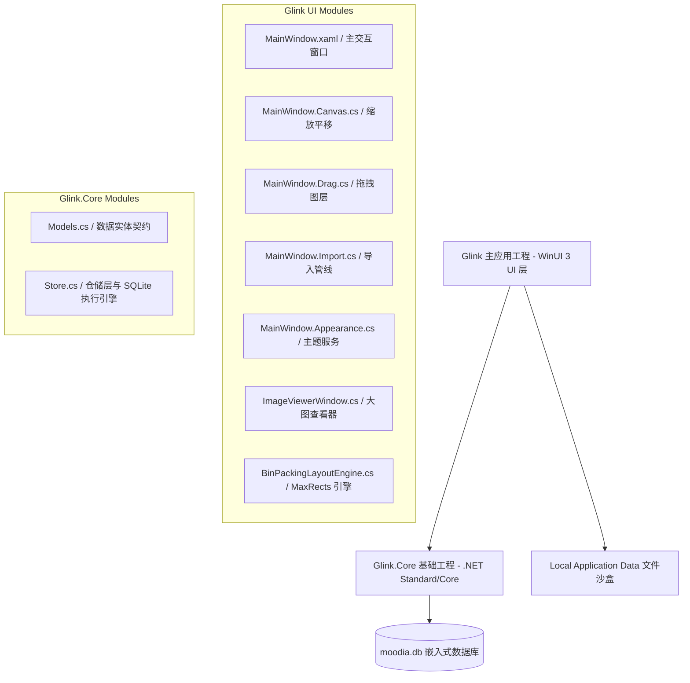
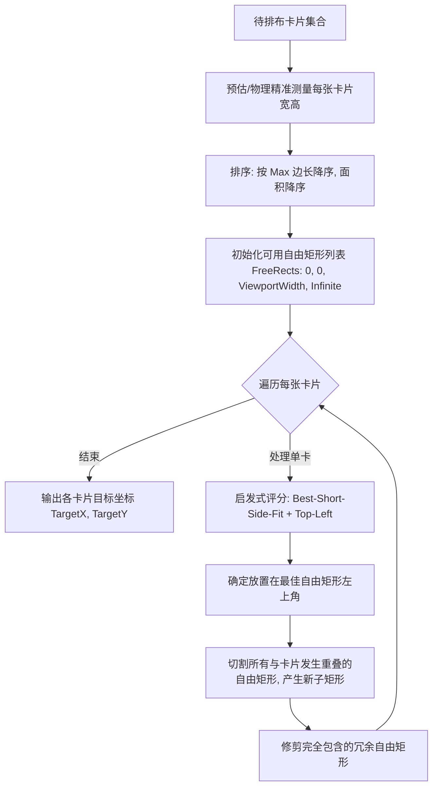
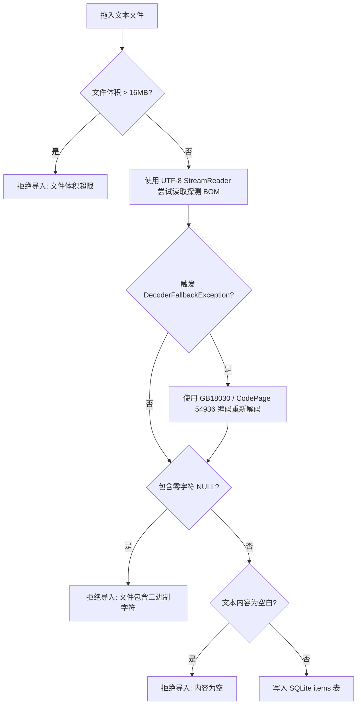
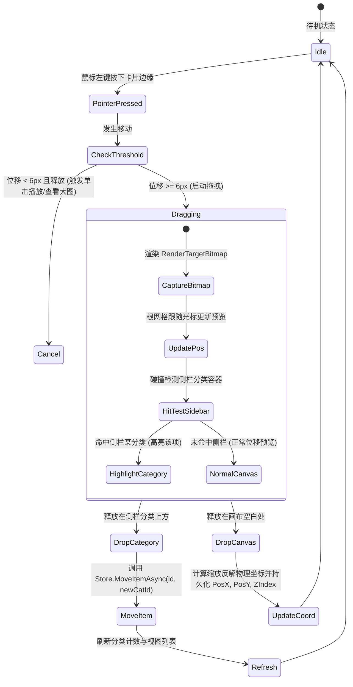

# Glink 软件需求清单与系统设计蓝图规范

本文档为 **Glink（灵感库）** 软件的完整设计与实现规范。旨在提供详尽的业务需求、系统架构、数据契约、UI/UX 布局图纸与核心算法细节，确保任何工程团队能够仅凭本文档，100% 高保真地复刻并还原该软件。

---

## 目录
- [一、 产品定位与核心价值](#一-产品定位与核心价值)
- [二、 需求清单（PRD 规格定义）](#二-需求清单prd-规格定义)
  - [2.1 情绪分类管理模块](#21-情绪分类管理模块)
  - [2.2 灵感沉淀与多模态资产模块](#22-灵感沉淀与多模态资产模块)
  - [2.3 多源拖拽与采集导入模块](#23-多源拖拽与采集导入模块)
  - [2.4 多维视图与流式筛选模块](#24-多维视图与流式筛选模块)
  - [2.5 无限画布与空间交互模块](#25-无限画布与空间交互模块)
  - [2.6 卡片交互与就地编辑模块](#26-卡片交互与就地编辑模块)
  - [2.7 外观主题引擎模块](#27-外观主题引擎模块)
  - [2.8 窗口自适应与状态持久化模块](#28-窗口自适应与状态持久化模块)
- [三、 系统架构与数据契约](#三-系统架构与数据契约)
  - [3.1 技术选型与运行环境](#31-技术选型与运行环境)
  - [3.2 解决方案工程拓扑](#32-解决方案工程拓扑)
  - [3.3 数据库物理设计（SQLite）](#33-数据库物理设计sqlite)
  - [3.4 文件沙盒与物理存储规范](#34-文件沙盒与物理存储规范)
  - [3.5 领域实体模型（C# Contract）](#35-领域实体模型c-contract)
- [四、 UI/UX 设计图纸与蓝图规范](#四-uiux-设计图纸与蓝图规范)
  - [4.1 窗口整体骨架与网格划分](#41-窗口整体骨架与网格划分)
  - [4.2 视觉设计系统（Design Tokens）](#42-视觉设计系统design-tokens)
  - [4.3 灵感卡片形态图纸与尺寸定义](#43-灵感卡片形态图纸与尺寸定义)
  - [4.4 独立图片查看器图纸（ImageViewerWindow）](#44-独立图片查看器图纸imageviewerwindow)
  - [4.5 动效与微交互曲线规范](#45-动效与微交互曲线规范)
- [五、 核心算法与关键技术实现细节](#五-核心算法与关键技术实现细节)
  - [5.1 MaxRects 二维装箱自动紧凑平铺算法](#51-maxrects-二维装箱自动紧凑平铺算法)
  - [5.2 稳健的文本编码嗅探与导入容错流水线](#52-稳健的文本编码嗅探与导入容错流水线)
  - [5.3 画布拖拽、Z-Index 管理与跨容器流转状态机](#53-画布拖拽z-index-管理与跨容器流转状态机)
  - [5.4 伪随机音频波形条生成与交互式 Seek 引擎](#54-伪随机音频波形条生成与交互式-seek-引擎)
  - [5.5 就地文本编辑防抖与关闭防丢闭环](#55-就地文本编辑防抖与关闭防丢闭环)
- [六、 还原落地实施路线与验收核对清单](#六-还原落地实施路线与验收核对清单)

---

## 一、 产品定位与核心价值

- **核心定位**：个人轻量化多模态灵感沉淀库。收纳文本、音频、图片、视频四类数字资产。
- **设计哲学**：
  - **卡片即内容本身**：剔除冗余外层包装、装饰性边框与繁杂的操作栏，内容呈现直截了当。
  - **沉浸克制**：暗色基底（低饱和度深灰与柔和主题）、纯色微交互、无渐变彩虹，视觉噪声最小化。
  - **非线性空间感**：突破传统单一垂直列表，提供具备空间记忆的自由二维画布与一键紧凑整理能力。
  - **零负担录入**：支持极速拖入、剪贴板粘贴、多文件并发解算、就地双击编辑。

---

## 二、 需求清单（PRD 规格定义）

### 2.1 情绪分类管理模块

| 编号 | 需求特性 | 详细描述 | 交互与边界逻辑 |
| :--- | :--- | :--- | :--- |
| FR-CAT-01 | 系统内置分类 | 应用首次运行时自动初始化唯一的根分类项：“全部灵感”。其固定强调色为 `#E8956B`，SortOrder 为 0。 | 不可被删除或重命名。侧栏顶部独立固定展示，显示库内条目总数。 |
| FR-CAT-02 | 自定义情绪意向分类 | 支持用户根据情绪、项目或灵感维度自由创建分类。属性包括：唯一标识 Id (UUID)、名称 Name (字符串)、强调色 AccentHex (8色环)、排序 SortOrder (递增整数)。 | 颜色取自预设 8 色循环调色板：`#E8956B`、`#D97BA6`、`#8FBF7F`、`#7BA6D9`、`#B39DDB`、`#6BC5C5`、`#D9C97B`、`#C58B6B`。 |
| FR-CAT-03 | 分类创建流程 | 点击侧栏底部“+ 新建分类”按钮，弹出标准 ContentDialog，包含单行名称输入框。点击“创建”生效。 | 自动分配当前色板序列中的下一强调色；自动计算最大排序序号递增；空名称禁止提交。 |
| FR-CAT-04 | 分类重命名 | 在侧栏分类项右键弹出上下文菜单，选择“重命名”，弹出 ContentDialog。 | 保存后即时刷新侧栏及当前内容区标头。 |
| FR-CAT-05 | 分类级联删除 | 在侧栏分类项右键弹出上下文菜单，选择“删除分类”，弹出二次确认对话框。 | 属于物理删除分类记录，但**不可删除其下包含的灵感条目**；关联的灵感条目其 CategoryId 字段自动置为 NULL（变为未分类状态）。 |
| FR-CAT-06 | 动态计数徽标 | 每个分类项右侧显示当前有效包含的灵感条目数量。 | 计数为 0 时隐藏徽标数字，大于 0 时直接展示数字字符串，并与数据库保持精准同步。 |
| FR-CAT-07 | 分类集合与拖拽整理 | 分类集合（文件夹）收纳子分类；侧栏行按住拖拽排序，落点归属由前驱行推导（拖入集合 = 落到集合头或其子行之后）。 | **拖出集合**：将子分类行拖到列表末行下方的空白放置区（文件树侧栏通用语义）即脱离集合、排到顶层末尾；拖到顶层行之间同样落顶层。集合子行结尾时列表底部取不到顶层槽位，空白放置区为唯一逃生口；右键"移动到 → 移出到顶层"等效。结构持久化走旁路文件 category-groups/order。 |
| FR-CAT-08 | 画布布局预设 | 右下角工具条"保存画布布局"按钮：命名后快照当前画布（条目集合 + 每张卡的坐标/层级/宽度，含手动调宽），持久化到旁路文件 `layout-presets.json`。 | 预设以**特殊条目**呈现在情绪意向列表末尾（强调色图标盒 + SemiBold 名称，区别于普通分类的彩色圆点；不参与拖拽/改色）。点击 → 画布按快照**原位**加载（跳过自动紧凑平铺），内容标题显示预设名；普通分类不携带布局信息、行为不变。右键管理：更新为当前画布（仅预设视图下可用，且在该视图保存即就地更新）/ 重命名 / 删除。预设成员为快照时的条目 Id 集合，条目删除后自动缺席，内容变更实时反映。 |

### 2.2 灵感沉淀与多模态资产模块

| 资产类型 | 支持格式扩展名 | 物理存储方案 | 展现形态与交互机制 |
| :--- | :--- | :--- | :--- |
| **文本 (Text)** | `.txt`, `.md`, `.markdown`, `.csv`, `.tsv`, `.json`, `.xml`, `.log`, `.rtf`, `.html`, `.htm` | 内容以字符串形式完整存入 SQLite `items.Content` 字段，不占用沙盒文件。 | 卡片直接渲染正文字符（字号 15px，行高 22px），支持换行包裹。双击卡片或右键“修改”进入就地编辑。 |
| **图片 (Image)** | `.png`, `.jpg`, `.jpeg`, `.gif`, `.bmp`, `.webp` | 拷贝至沙盒目录 `%LOCALAPPDATA%\Glink\media\{Guid}{ext}`。 | 按原生宽高比渲染无裁剪缩略图（载入阶段节流解码宽度至 800px 以节约显存），单击直接弹出独立的全屏查看窗口。 |
| **音频 (Audio)** | `.mp3`, `.wav`, `.flac`, `.m4a`, `.ogg`, `.aac`, `.wma`, `.opus` | 拷贝至沙盒目录 `%LOCALAPPDATA%\Glink\media\{Guid}{ext}`。 | 高度 56px 动态波形条，使用卡片 Id 散列计算随机柱高。点击卡片任意区域或播放按钮触发音频播放/暂停；在波形区域按住滑动可实时跳转播放进度（Seek）。 |
| **视频 (Video)** | `.mp4`, `.mov`, `.mkv`, `.webm`, `.avi`, `.wmv` | 拷贝至沙盒目录 `%LOCALAPPDATA%\Glink\media\{Guid}{ext}`。 | 占位视频框（深色纯净底色 + 52px 圆环播放图标）以及文件名与创建时间标注。点击触发系统播放链路。 |

### 2.3 多源拖拽与采集导入模块

| 编号 | 需求特性 | 规格要求 |
| :--- | :--- | :--- |
| FR-IMP-01 | 全局拖拽响应区 | 整个主窗口根网格（`RootGrid`）与内容区画布均设置 `AllowDrop="True"`，全域侦听外来拖入。 |
| FR-IMP-02 | 拖入视觉遮罩 (Drop Overlay) | 当检测到合法外部载荷悬停于窗口上方时，毫秒级渐现半透明蒙层（`Opacity="0.96"`，带圆角 16px、主色 2px 边框的提示框，文案：“释放以添加灵感”）。离开窗口 100ms 后自动隐藏。 |
| FR-IMP-03 | 多格式兼容探测 | 依次适配：<br>1. 系统文件对象（`StandardDataFormats.StorageItems`）；<br>2. 位图对象（`StandardDataFormats.Bitmap`，按字节头识别原格式原样保存，识别失败时转码 PNG）；<br>3. 网络与应用链接（`WebLink`, `ApplicationLink`, `Uri`）；<br>4. 剪贴板文本行（多行皆为绝对路径则按文件批量导入，否则作为整段纯文本导入）。 |
| FR-IMP-04 | 异步流式写入与故障隔离 | 批量拖入 100+ 文件时，文件以 80KB 缓冲区异步流式写入磁盘，内存占用平稳。单文件失败不中断批处理；通过底部 `InfoBar` 汇报：“成功导入 X 项，跳过/失败 Y 项”。 |
| FR-IMP-05 | 事务与防悬空文件机制 | 写入文件系统与写入 SQLite 紧密偶合；若数据库插入失败，立即物理删除刚生成的沙盒文件，严禁残留孤儿文件。 |
| FR-IMP-06 | 剪贴板粘贴导入 | 复制文本、图片或音视频文件后，在主窗口按 `Ctrl + V`（可在设置中改键）快速导入：文本生成文字卡，图片按原格式入库，音频/视频文件复制进沙盒。新卡片落在当前鼠标光标所在的画布位置（多项内容按 24px 级联摆放）；光标不在画布或列表视图时回退自动平铺。剪贴板无可用内容时以 `InfoBar` 提示，不弹对话框。输入框与对话框内的粘贴保持原生行为，不触发导入。 |

### 2.4 多维视图与流式筛选模块

```
[全部] [文本] [图片] [音频] [视频]  -----------  [全部时间] [今日] [近7天] [更早]
```

- **类型筛选 (Type Chips)**：互斥切换。可选值包括：全部（默认）、文本、图片、音频、视频。
- **时间筛选 (Time Chips)**：互斥切换。可选值包括：
  - 全部时间：无时间边界限制。
  - 今日：`CreatedAt >= 今日 00:00:00`。
  - 近7天：`CreatedAt >= 今日零点 - 6天`（覆盖包含今日在内的过去连续 7 天）。
  - 更早：`CreatedAt < 今日零点 - 6天`。
- **空状态差异化反馈 (Empty States)**：
  - 无任何灵感时显示：“留一个位置，给新的灵感 —— 拖入或粘贴图片、音频或视频，也可以写下一段文字。”
  - 筛选后无结果时显示：“没有符合筛选的灵感 —— 试试其他类型，或切换到全部时间。”

### 2.5 无限画布与空间交互模块

- **自由画布尺寸**：初始虚拟画布容器尺寸为 `6000 x 4000` 像素，当卡片被拖动至边界外侧时，动态自动拓展画布宽高（至少保持当前所有卡片最大右下角 + 48px 余量）。
- **平移与缩放 (Pan & Zoom)**：
  - 缩放操作：按住 `Ctrl` 键并滚动鼠标滚轮，或通过键盘快捷键 `Ctrl + Plus` / `Ctrl + Minus` 进行缩放。
  - 粘贴导入：全局 `Ctrl + V` 读取剪贴板（文本/位图/文件），新卡片落位在鼠标光标处的画布内容坐标。
  - 缩放区间：`25%` 至 `250%`。
  - 光标锚定：缩放算法保持当前鼠标光标指向的画布逻辑内容坐标不发生偏移。
  - 100% 重置：右下角常驻悬浮控制球，实时显示当前百分比（如 `100%`），点击即刻平滑重置至 1.0 比例并将视角居中。
  - 中键平移：按住鼠标中键在画布任意位置（含卡片上方）拖拽平移视图；滚出内容边界时自动重定基（卡片整体平移等效量），实现等效无限画布。
- **多选与批量操作 (Multi-Select)**：
  - 框选：`Shift` + 鼠标左键拖拽绘制半透明主题色选框，松开后与选框相交的卡片全部入选；拖拽中按住 `Ctrl` 为增量选择（不清除已有选中）。
  - 点选：`Ctrl` + 鼠标左键单击卡片，切换该卡片的选中态（增选/减选）。
  - 选中视觉：被选卡片边框临时替换为 2px 强调色（`AccentBrush`），悬停与分类换色均不覆盖选中视觉。
  - 批量菜单：选中 ≥2 张卡片后右键任一选中卡片，弹出批量菜单：已选计数、归类到…（全部分类 + 移出分类）、收藏/取消收藏、删除（警告对话框确认）、取消选择。
  - 批量操作均为单步撤销：批量删除走 `ArchivedItems` 归档（可整体还原媒体与数据），批量归类记录原分类映射用于撤销。
  - 选择是视图级状态：切换分类/筛选/刷新即清空，不写库；`Esc` 键或点击空白处/未选中卡片亦可清空。
- **紧凑平铺 (MaxRects Auto-Pack)**：
  - 右下角工具条提供“紧凑平铺”按钮。
  - 点击后触发二维装箱算法，为所有可见卡片重新计算紧密贴合且零重叠的目标坐标。
  - 采用 280ms 的三次减速曲线（Cubic Ease-Out）驱动所有卡片从当前坐标平滑滑动就位。

### 2.6 卡片交互与就地编辑模块

- **悬停质感**：光标移入卡片，卡片在 150ms 内沿 Y 轴平滑微浮 `-2px`，边框颜色从 `BorderBrush` 切换为亮态 `BorderHoverBrush`。
- **双击就地编辑 (Inline Editing)**：
  - 针对文本卡片，双击卡片正文或右键选择“修改”，静态 `TextBlock` 隐藏，原位切换为多行 `TextBox`。
  - 文本框自动获得焦点并选定末尾。
  - **快捷键规范**：`Shift + Enter` 或 `Ctrl + Enter` 输入换行；单按 `Enter` 键触发确认保存；按 `Escape` 键放弃修改并恢复原文字。
  - **失焦与防丢兜底**：光标点击卡片外空白区域自动保存；即使窗口正在关闭，后台队列保证未落盘修改完成持久化后方才退出进程。
- **卡片上下文菜单 (MenuFlyout)**：
  - 右键任意卡片弹出克制菜单（仅 4 项）：
    1. 修改（仅文本卡片展示）；
    2. 收藏（切换 `IsFavorite` 状态，元信息中打上星号标记）；
    3. 复制文本（仅文本卡片展示，将文本压入系统剪贴板）；
    4. 删除（弹出警告对话框，确认后物理清理数据库与沙盒存储）。
- **小缩放比例下的文本自适应（Text Fit）**：
  - 触发：画布缩放 < 80%（15px 正文屏显不足 12px）时启用；≥ 80% 全部还原（字号与换行槽）。
  - **卡片内部空间利用**（框尺寸严格不变的前提）：
    - 水平：默认换行槽 320（卡宽 360 − 2×20 内边距）；小缩放下正文负边距 −12 拓宽到 344（文字距卡缘 8px）。
    - 垂直：日期行隐藏后仍占位（10+17px），单行文本放大的字形可溢入该空间渲染（不参与布局），单行字号上限 3.0×（25% 缩放下屏幕约 11px 可读）。
  - **核心不变量：换行行数与基线完全一致**（多一行撑高、少一行缩高均不允许）：
    - 单行：放大后宽度 ≤ 344×96%（防折行），逐档试号并实测锁定高度恰为 22。
    - 多行：按换行槽 320→344 的宽度增益等比放大（≤1.07×），换行断点几何不变、行数不变；实测失败则整体还原该卡不适配。
    - 次要信息（日期/收藏标记）小缩放下以 `Opacity=0` 隐藏（保留占位）。
  - 基线（自然宽度与行数）在默认状态首测并缓存于 `TextBlock.Tag`；缩放变化经 150ms 去抖后统一应用。
- **卡片边缘调整大小（标准 8 向把手算法）**：悬停命中卡片外缘"把手环"（环宽按画布缩放补偿、屏幕恒约 8 DIP，且不超过边长 1/3 防重叠；角优先于边）时，卡片边框点亮为主题强调色 2px，并显示对应标准系统调整光标（左右 ↔、上下 ↕、西北/东南 ↖↘、东北/西南 ↗↙）。各类型可用把手：**图片** 8 向全开（四角等比缩放，取主导轴；上下边拖高、宽随纵横比联动）、**视频** 左右边 + 上边 + 上两角（底部为进度条/页脚/放大按钮交互件，不放 South 及下两角，下角自然降级为左右把手；把手命中让位放大按钮）、**文本/音频** 仅左右边（高度随内容自适应）。拖拽几何为画布坐标系的标准边缘拖拽：被拖边跟随指针、对边锚定不动（拖左缘锚右缘/拖上缘锚下缘），宽度钳制 150–800，左/上锚定不得越过画布原点（负坐标不可达）。文本卡实时重排换行并复位缩放适配基线、图片/视频按原纵横比联动换高（视频画面高度钳制 140–760）、音频波形随宽度重画；Ctrl/Shift 组合键、拖动、多选手势与点按播放（视频表面）不受影响，多点触控下仅跟踪起手指针，Esc/指针捕获丢失会安全终止会话。**松手后不自动重排**——卡片保持原位原样，画布仅按需扩展边界（自由画布语义）。尺寸为会话级状态（刷新后回到按内容自动计算；布局预设快照含视频卡宽度，加载时按同口径恢复画面高度）。
- **拖拽至分类流转**：
  - 鼠标左键按下卡片并拖动位移超过 6px 后，触发卡片拖拽态。
  - 根层捕获生成卡片真实外观的 `RenderTargetBitmap` 半透明截图（`Opacity=0.94`，带 `ThemeShadow` 与 Z 轴 32px 景深投影）。
  - 当拖动经过左侧分类列表时，目标分类项显示背景高亮，拖拽悬浮提示条显示“移入「分类名」”。释放鼠标后，卡片所属分类完成流转，主视图自动更新。

### 2.7 外观主题引擎模块

系统内置 4 套精心调校的自然主题，所有颜色均经低刺激度调配：

| 主题 Id | 中文命名 | 调性与设计定位 | 底色 (Bg) | 侧栏 (Sidebar) | 卡片 (Card) | 边框 (Border) | 强调色 (Accent) |
| :--- | :--- | :--- | :--- | :--- | :--- | :--- | :--- |
| `twilight` | **暮光** (默认) | 暖炭灰与柔杏色，安静收纳每一份灵感 | `#151413` | `#1C1A18` | `#25221F` | `#3B3631` | `#E9AC83` |
| `paper` | **晨纸** | 浅色模式，温润纸白与陶土红，轻盈清晰 | `#F5F2EB` | `#ECE7DE` | `#FFFDFA` | `#D6CFC3` | `#9C3F2A` |
| `midnight` | **夜航** | 深海蓝与冰川青，专为专注夜晚打造 | `#111922` | `#17222D` | `#1E2C39` | `#344758` | `#8BCBDB` |
| `forest` | **松林** | 苔绿与浅金，沉静自然且富有呼吸感 | `#161C18` | `#1D2721` | `#26332A` | `#405045` | `#C9D59A` |

- **即时热更新**：点击设置抽屉单选切换主题时，就地修改 `Application.Current.Resources` 映射的 `SolidColorBrush.Color`，无需重新启动应用或重新加载视觉树。
- **原生标题栏同步**：无缝联动 Windows 系统级窗口标题栏按钮（最小化、最大化、关闭）的背景色、前景色、悬停色与按下色。
- **持久化保存**：主题 Id 以纯文本形式原子写入 `%LOCALAPPDATA%\Glink\appearance.txt`。

### 2.8 窗口自适应与状态持久化模块

- **响应式折叠**：当右侧内容区宽度小于 700px 时，时间筛选栏自动换行排列至类型筛选栏下方，确保各分辨率下均无元素重叠。
- **原生拖拽区扩展**：窗口标题栏与大标题空白区域均注册为系统非客户区拖拽句柄（`NonClientRegionKind.Caption`），保留原生窗口拖拽与 Snap 贴靠布局手势。
- **窗口几何记忆**：实时节流监听窗口位置（X, Y）与尺寸（Width, Height），原子记录于 `%LOCALAPPDATA%\Glink\window.txt`，冷启动时恢复至上次关闭状态。

---

## 三、 系统架构与数据契约

### 3.1 技术选型与运行环境

- **运行平台**：Windows 11 / Windows 10 (Version 1809+ / Build 17763+)。
- **应用框架**：WinUI 3 (Windows App SDK 2.5.1+)。
- **运行时环境**：.NET 10.0 (`net10.0-windows10.0.26100.0`)，C# 13+。
- **存储引擎**：SQLite 嵌入式数据库，采用官方驱动 `Microsoft.Data.Sqlite` (版本 9.0.x)。
- **媒体播放**：系统原生 `Windows.Media.Playback.MediaPlayer`。

### 3.2 解决方案工程拓扑



### 3.3 数据库物理设计（SQLite）

数据库物理文件路径为：`%LOCALAPPDATA%\Glink\moodia.db`。若设置了环境变量 `MOODIA_DATA_ROOT`，则优先采用该环境变量指定的根路径。

#### 表 1：categories（分类表）

```sql
CREATE TABLE IF NOT EXISTS categories (
    Id TEXT PRIMARY KEY,            -- UUID 字符串，主键
    Name TEXT NOT NULL,             -- 分类显示名称（例如：全部灵感、建筑意向）
    AccentHex TEXT NOT NULL,        -- 关联的强调色 HEX 代码（例如：#E8956B）
    SortOrder INTEGER NOT NULL      -- 排序权重，自增整数，升序排列
);
```

#### 表 2：items（灵感条目表）

```sql
CREATE TABLE IF NOT EXISTS items (
    Id TEXT PRIMARY KEY,            -- UUID 字符串，主键
    Type INTEGER NOT NULL,          -- 资产类型枚举：0=Text, 1=Image, 2=Audio, 3=Video
    Content TEXT,                   -- 纯文本卡片的正文内容；媒体卡片可为空
    FilePath TEXT,                  -- 媒体相对于沙盒根目录的路径（例如：media/xxx.png）
    FileName TEXT,                  -- 原始文件名称（含扩展名，例如：design_sketch.png）
    SizeBytes INTEGER NOT NULL,     -- 资产字节大小（Byte）
    CategoryId TEXT,                -- 外键，关联 categories.Id，可为 NULL（未分类）
    CreatedAt TEXT NOT NULL,        -- ISO-8601 标准时间字符串（含毫秒与时区）
    Note TEXT,                      -- 用户备忘与注释（预留）
    IsFavorite INTEGER NOT NULL DEFAULT 0, -- 收藏标记：0=未收藏, 1=已收藏
    PosX REAL,                      -- 画布 X 轴坐标（浮点数，为空则由自动布局计算）
    PosY REAL,                      -- 画布 Y 轴坐标（浮点数，为空则由自动布局计算）
    ZIndex INTEGER NOT NULL DEFAULT 0 -- 画布堆叠层级（整数，数值越大显示越在上层）
);

-- 核心查询索引
CREATE INDEX IF NOT EXISTS idx_items_category ON items(CategoryId);
CREATE INDEX IF NOT EXISTS idx_items_created ON items(CreatedAt);
```

### 3.4 文件沙盒与物理存储规范

- **根目录定义**：`%LOCALAPPDATA%\Glink\`。
- **媒体存储目录**：`%LOCALAPPDATA%\Glink\media\`。
- **命名规范**：媒体物理文件统一使用 `Guid.NewGuid().ToString() + 原文件扩展名` 进行持久化存储，屏蔽操作系统对特殊文件名字符的解析异常。
- **文本卡片边界约束**：文本文件导入上限为 `16 MB`；如检测到包含空字符 `\0`，立即判定为二进制文件并拦截终止，防止乱码注入。

### 3.5 领域实体模型（C# Contract）

```csharp
namespace Glink.Core;

public enum ItemType 
{ 
    Text = 0, 
    Image = 1, 
    Audio = 2, 
    Video = 3 
}

public sealed class MoodCategory
{
    public Guid Id { get; set; }
    public string Name { get; set; } = string.Empty;
    public string AccentHex { get; set; } = "#E8956B";
    public int SortOrder { get; set; }
}

public sealed class Item
{
    public Guid Id { get; set; }
    public ItemType Type { get; set; }
    public string? Content { get; set; }
    public string? FilePath { get; set; }
    public string? FileName { get; set; }
    public long SizeBytes { get; set; }
    public Guid? CategoryId { get; set; }
    public DateTime CreatedAt { get; set; }
    public string? Note { get; set; }
    public bool IsFavorite { get; set; }
    public double? PosX { get; set; }
    public double? PosY { get; set; }
    public int ZIndex { get; set; }
}
```

---

## 四、 UI/UX 设计图纸与蓝图规范

### 4.1 窗口整体骨架与网格划分

主窗口设计基准尺寸为 `1280 x 800`，最低适配尺寸为 `900 x 600`。

```
+---------------------------------------------------------------------------------------+
| [Glink] 标题栏区域 (沉浸式原生拖拽顶条, Height: 40px)                [—] [口] [X]    |
+-------------------+-------------------------------------------------------------------+
| 侧边栏 (240px)    | 内容工作区 (Grid.Column="1", Width="*")                           |
| Background:       |                                                                   |
| SidebarBrush      | [标头区: 分类小圆点 + 分类大标题 + 条目数]        [+ 添加灵感主按钮]  |
|                   |                                                                   |
| "你的灵感，       | [类型筛选 Chips]                        [时间筛选 Chips]          |
|  随光沉淀"        | [全部][文本][图片][音频][视频]          [全部时间][今日][近7天][更早] |
|                   |-------------------------------------------------------------------|
| [全部灵感  (42)]  | 虚拟自由画布视口 (ScrollViewer + Canvas 6000x4000)                |
|                   |                                                                   |
| 情绪意向          |   +-----------+    +---------------+    +---------------------+   |
| · 建筑立面  (12)  |   | 文本卡片  |    | 图片卡片      |    | 音频卡片 (波形)     |   |
| · 界面质感   (8)  |   | 360 x H   |    | 360 x H(自适应)|   | 360 x 100           |   |
| · 氛围声音   (5)  |   +-----------+    +---------------+    +---------------------+   |
|                   |                                                                   |
|                   |                                                [100% 重置] [平铺] |
|-------------------|                                                                   |
| [+ 新建分类]      | [拖拽导入全屏遮罩 / 底部错误通知 InfoBar / 右侧弹出设置抽屉]       |
| [设置]            |                                                                   |
+-------------------+-------------------------------------------------------------------+
```

### 4.2 视觉设计系统（Design Tokens）

#### 4.2.1 基础度量基准
- **间距模数**：以 4px 为基础网格步长（常用步长：4px, 8px, 12px, 16px, 20px, 24px, 32px）。
- **圆角规范**：
  - 卡片大容器：`12px`
  - 筛选 Chip 胶囊：`8px`
  - 侧栏项与主按钮：`8px`
  - 设置与输入框控件：`6px` 或 `4px`
- **阴影与景深**：
  - 普通卡片：平面底色 + 1px 细边框，无常驻重阴影。
  - 拖拽卡片：Z 轴提升 32px，施加系统级 `ThemeShadow` 与 `Opacity=0.94`。

#### 4.2.2 字体排版规格
- **显示标题字体**：`Segoe UI Variable Display`
  - 窗口主标题：15px，SemiBold
  - 内容区大标题：28px，SemiBold
  - 设置抽屉大标题：24px，SemiBold
- **正文字体**：`Segoe UI`
  - 侧栏副标题：12px，Regular，颜色：SubTextBrush
  - 分类导航项：14px，Regular，颜色：TextBrush
  - 卡片正文：15px，Regular，LineHeight: 22px，颜色：TextBrush
  - 卡片元信息与角标：11px，Regular，颜色：SubTextBrush

### 4.3 灵感卡片形态图纸与尺寸定义

所有卡片具有统一宽度：**固定 360px**（内边距或内容区域按类型自适应）。

#### 4.3.1 文本卡片（Text Card）

- **初始尺寸按内容长度约束**：卡宽 = 不换行自然宽度 + 64（内边距 40 + 视觉余量 24），钳制在 `150 ~ 360`；短文本得到紧凑便签卡，长文本为标准宽卡。所有文本卡结构性最小高度 116 且内容**垂直居中**（便签比例，为小缩放下的正文放大预留真实可用的内容盒）。
- **水平居中设置（默认开，`text-prefs.txt` 持久化）**：仅控制单行文本与日期行的水平对齐（多行长文恒左对齐；垂直居中为结构性设计，不受此开关影响）。
- **字体设置（`text-prefs.txt` 的 `font=` 行）**：设置面板"文本卡片字体"跨主题菜单选择（默认 Segoe UI / 微软雅黑 / 等线 / 黑体 / 楷体 / 宋体，菜单项用各自字体预览），正文与就地编辑框同步应用；未安装的字体由系统静默回退。
- **缩放适配的可利用空间 = 内容盒（卡框减四边内边距，fit-to-container 共识目标）**：
  - 换行槽 = 卡宽 − 40（侧边距恒不被占用）。
  - 垂直：小缩放下单行字号放大（≤3.0×，宽度 ≤ 槽 × 96% 防折行），**行高按 1.45× 随字号真实增长并封顶内容盒高（卡高 − 40）**，日期行 Collapsed 腾位——放大文字四边边距真实存在，卡片框高度恒定零变化。
  - 多行文本保持原字号（换行槽内无宽度增益可用）；多行卡日期行 Opacity=0 占位。
- **外边框**：Padding = `20px`。
- **内容布局**：
  - 顶部：多行文本块（字号 15px，行高 22px，自动换行）。
  - 底部：间距 10px，元数据文本（格式：`[★]  MM/dd HH:mm`）。

```
+----------------------------------------------+
| (Padding: 20px)                              |
|                                              |
| 留白不是空白，而是给思维呼吸的余量。         |
| 每一张卡片都不需要多余的标题栏。             |
|                                              |
|                                              |
| ★  10/24 01:30                               |
+----------------------------------------------+
```

#### 4.3.2 图片卡片（Image Card）
- **外边框**：Padding = `0px`（图片直通贴边）。
- **图片呈现**：圆角 `11px`，拉伸模式 `Stretch.Fill`，高度严格依从原图纵横比：`Height = 358.0 * PixelHeight / PixelWidth`。
- **悬停提示**：鼠标移上显示 ToolTip（包含文件名与创建时间）。

```
+----------------------------------------------+
| [==========================================] |
| [                                          ] |
| [             图片位图直显                 ] |
| [       高度按原始比例渲染，解码限制800px  ] |
| [                                          ] |
| [==========================================] |
+----------------------------------------------+
```

#### 4.3.3 音频卡片（Audio Card）
- **外边框**：Padding = `20px`。
- **结构拆解**：
  - 顶部波形容器：圆角 6px，背景取 `SidebarBrush`。内部波形 Canvas 高度 `56px`。波形柱宽 3px，间距 2px。已播放部分填充 `AccentBrush`，未播放部分填充 `WaveformBrush`。
  - 底部元数据栏：左侧播放/暂停字形图标（14px）；中间音频原始文件名（省略号截断）；右侧时间戳。

```
+----------------------------------------------+
|  +----------------------------------------+  |
|  | |||||||||||||||||||||||||||||||||||||| |  |
|  | |||||||||||||||||||||||||||||||||||||| |  |  <- 56px 波形条
|  +----------------------------------------+  |
|                                              |
|  (>)  海浪采样录音_01.wav       10/24 01:25   |
+----------------------------------------------+
```

#### 4.3.4 视频卡片（Video Card）
- **外边框**：Padding = `0px`。
- **结构拆解**：
  - 顶部：高度 220px 纯黑灰色占位网格，中央嵌套 52px 圆形半透明按钮及 18px 播放三角字形。
  - 底部：边距 16px，包含文件名与时间戳。

```
+----------------------------------------------+
| [==========================================] |
| [                  ( > )                   ] | <- 220px 纯净背景
| [==========================================] |
|  光影延时测试.mp4                            |
|  10/24 01:10                                 |
+----------------------------------------------+
```

### 4.4 独立图片查看器图纸（ImageViewerWindow）

当在图片卡片上单击时，弹出独立大图窗口：
- **无边框沉浸**：`ExtendsContentIntoTitleBar = true`，窗口居中于主程序窗口。
- **尺寸策略**：根据显示器工作区动态计算，窗口宽高初次加载不超过主屏幕宽高的 `85%`。
- **操作手势体系**：
  - **拖动**：鼠标左键按住图片任意位置自由拖拽，1:1 跟手移动。
  - **缩放**：以当前光标所在点为缩放中心，滚轮平滑缩放。
  - **切换大小**：双击图片在“100% 原始像素大小”与“窗口自适应大小”之间瞬时切换。
  - **关闭**：按 `Escape` 键或点击右上角关闭按钮退出。

### 4.5 动效与微交互曲线规范

- **卡片悬停微浮**：
  - 作用属性：`TranslateTransform.Y`
  - 变化区间：`0px -> -2px`
  - 时长与曲线：`150ms`，`ExponentialEase (EasingMode.EaseOut)`
- **分类切换标题淡入**：
  - 作用属性：`Opacity`
  - 变化区间：`0.0 -> 1.0`
  - 时长与曲线：`200ms`，`ExponentialEase (EasingMode.EaseOut)`
- **紧凑平铺补间过渡**：
  - 作用属性：`Canvas.Left`, `Canvas.Top`
  - 时长与曲线：`280ms`，`Cubic Ease-Out`（计算公式：`ease = 1.0 - (1.0 - t)^3`，以 16ms 帧率驱动）。

---

## 五、 核心算法与关键技术实现细节

### 5.1 MaxRects 二维装箱自动紧凑平铺算法

为了在不同分辨率和卡片异构高度（短文本 80px、长文本 300px、视频 280px、图片随纵横比动态变化）下实现最高密度且零重叠的排布，Glink 采用 **MaxRects（最大矩形）装箱算法**：

#### 算法流程拓扑


#### 关键约束与启发式公式
1. **可用排布宽度计算**：
   $$\text{BinWidth} = \max\left(\text{MaxSingleCardWidth}, \frac{\text{ViewportWidth} - 2 \times \text{OriginX}}{\text{ZoomFactor}}\right)$$
2. **Best-Short-Side-Fit (BSSF) 评估法则**：
   对于自由矩形 $F$ 和待放入卡片 $C$（含间隙）：
   $$\text{LeftoverX} = F.\text{Width} - C.\text{Width}, \quad \text{LeftoverY} = F.\text{Height} - C.\text{Height}$$
   $$\text{ShortSideFit} = \min(\text{LeftoverX}, \text{LeftoverY})$$
   择取使得 $\text{ShortSideFit}$ 最小且 $F.\text{Y}$ 最小（Top-Left 优先）的放置点。

### 5.2 稳健的文本编码嗅探与导入容错流水线

在处理用户由旧版记事本、代码编辑器或中文 Windows 导出的 `.txt` / `.md` 文件时，必须防止乱码或空崩溃：



### 5.3 画布拖拽、Z-Index 管理与跨容器流转状态机



### 5.4 伪随机音频波形条生成与交互式 Seek 引擎

1. **确定性波形生成**：
   无需在导入时启动耗时的离线声学解码分析，直接采用卡片 UUID 散列值作为伪随机种子：
   ```csharp
   var rng = new Random(vm.Id.GetHashCode());
   for (int i = 0; i < totalBars; i++)
   {
       var barHeight = 4.0 + rng.NextDouble() * (canvasHeight - 6.0);
       // 绘制圆角柱状条 (RadiusX=1.5, RadiusY=1.5)
   }
   ```
2. **高频进度重绘优化**：
   在 `ProgressTimer_Tick`（100ms 间隔）驱动播放进度更新时，波形柱元素完全复用，仅比对并修改柱状条的 `Fill` 画刷引用（`AccentBrush` 或 `WaveformBrush`），杜绝重复创建 UI 节点导致的 GC 停顿与界面闪烁。
3. **Seek 交互与拖拽解耦**：
   仅当光标点击波形柱区域时，启动捕获并计算比率 $Ratio = \text{Clamp}(X / Width, 0.0, 1.0)$；点击卡片外圈边框区域则作为整体卡片移动的拖动手柄，二者互不干扰。

### 5.5 就地文本编辑防抖与关闭防丢闭环

1. **异步写入锁链**：
   ```csharp
   _textSaveTask = SaveTextAfterAsync(_textSaveTask, vm, newValue);
   ```
   所有保存任务通过前序 `Task` 串联执行，杜绝多任务并发写入 SQLite 导致的数据库加锁冲突（`database is locked`）。
2. **应用退出阻断安全阀**：
   在 `AppWindow.Closing` 事件中检查 `_unsavedText` 内存字典：
   ```csharp
   AppWindow.Closing += async (_, args) =>
   {
       EndInlineEdit(save: true);
       if (_textSaveTask.IsCompleted && _unsavedText.Count == 0) return;
       args.Cancel = true; // 拦截窗口关闭
       await _textSaveTask; // 等待落盘完毕
       if (_unsavedText.Count == 0) Close(); // 再次发起安全关闭
   };
   ```

---

## 六、 还原落地实施路线与验收核对清单

第三方团队在复刻此软件时，建议严格遵循以下分步里程碑：

### 阶段一：基础架构与存储层落地
- [ ] 创建 .NET 10 类库工程 `Glink.Core`，引入 `Microsoft.Data.Sqlite 9.0.x`。
- [ ] 按照 3.3 节完成建库、建表、索引与 PosX/PosY/ZIndex 字段迁移脚本。
- [ ] 实现 `Store.cs` 静态服务：全量分类 CRUD、基于时间与类型的联合筛选、沙盒文件安全拷贝。
- [ ] 编写轻量单元测试，覆盖 16MB 文本、ANSI/UTF-8 编码读取及沙盒异常清理逻辑。

### 阶段二：UI 脚手架与设计系统构建
- [ ] 创建 WinUI 3 应用工程 `Glink`，引入 `Microsoft.WindowsAppSDK 2.5.1`。
- [ ] 在 `App.xaml` 登记 4 套主题的核心画刷、卡片样式与文本层级样式。
- [ ] 构建 `MainWindow.xaml`：实现沉浸式标题栏、左侧 240px 侧栏与右侧内容区。
- [ ] 实现 `ThemeService.cs`，验证主题热切换与系统标题栏按钮配色联动。

### 阶段三：卡片工厂与多模态渲染
- [ ] 实现卡片工厂方法 `CreateCanvasCard` 与 `BuildCardContent`。
- [ ] 实现文本卡片与双击就地编辑状态机（Enter 保存，Shift+Enter 换行，Esc 放弃）。
- [ ] 实现图片卡片与自适应纵横比，配置 `ImageViewerWindow` 大图全屏查看器。
- [ ] 实现音频卡片波形生成、`MediaPlayer` 播放/暂停控制与拖动 Seek。
- [ ] 实现视频卡片占位视图。

### 阶段四：无限画布、装箱算法与拖拽流转
- [ ] 在 `CanvasScroll` 实现 Ctrl+滚轮以光标为中心缩放（0.25x - 2.5x）与 100% 重置。
- [ ] 实现 `BinPackingLayoutEngine.cs`，集成 MaxRects 二维装箱算法。
- [ ] 集成 280ms Cubic Ease-Out 平铺重排动画。
- [ ] 实现卡片自由拖动定位与拖入侧边栏分类流转逻辑。

### 阶段五：外部拖入采集与整体验收
- [ ] 实现 `ExternalDropImporter.cs`，打通文件、文本行与 URL 的拖拽解析。
- [ ] 实现全局半透明拖入浮层提示。
- [ ] 实现窗口位置和尺寸记忆持久化。
- [ ] 对照下述验收标准进行全量回归。

---

### 全功能验收核对清单表

| 序号 | 验证模块 | 测试用例与通过条件 | 验收状态 |
| :---: | :--- | :--- | :--- |
| 1 | 数据存储 | 首次启动自动建立 `moodia.db`，自动初始化“全部灵感”分类。 | [PASS] |
| 2 | 分类管理 | 新建分类循环赋予 8 色中的强调色；重命名后标头即刻更新；删除分类后条目保留。 | [PASS] |
| 3 | 文本录入 | 点击添加文字保存，卡片立即上屏；双击就地修改按 Enter 保存成功。 | [PASS] |
| 4 | 外部拖拽 | 从资源管理器同时拖入 10 张图片、2 段音频、1 个文本，成功全部导入且无卡顿。 | [PASS] |
| 5 | 图片查看 | 单击图片卡片唤起大图窗口；滚轮缩放跟手；双击在适屏与 100% 切换；Esc 退出。 | [PASS] |
| 6 | 音频播放 | 点击播放图标音频播放且图标切换；波形随进度着色；在波形上滑动可拖动进度。 | [PASS] |
| 7 | 画布交互 | Ctrl+滚轮以鼠标为中心平滑缩放；右下角重置为 100%；拖动卡片 Z 层级提升。 | [PASS] |
| 8 | 紧凑平铺 | 点击右下角平铺按钮，卡片以 280ms 缓动动画聚拢排列，彼此零重叠。 | [PASS] |
| 9 | 分类流转 | 拖动卡片至左侧栏某分类，释放后条目成功转入该分类，两边计数自动同步。 | [PASS] |
| 10 | 主题切换 | 在设置中切换“暮光/晨纸/夜航/松林”，界面底色、侧栏、卡片与标题栏同步瞬时切换。 | [PASS] |
| 11 | 窗口记忆 | 调整窗口位置与尺寸，关闭应用后重启，窗口精准恢复到上次关闭的位置与大小。 | [PASS] |
| 12 | 剪贴板粘贴 | 分别复制文本、截图位图、音频与视频文件后在画布光标处按 Ctrl+V，内容全部导入且新卡片落在光标位置。 | [PASS] |
